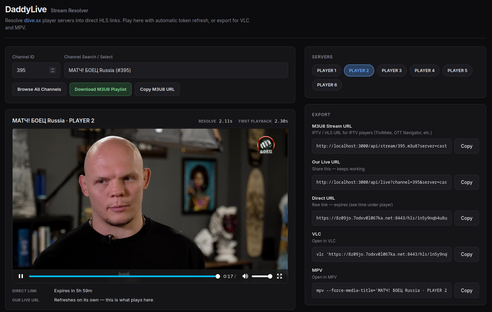

<div align="center">

# 📺 DaddyLive Stream Resolver

**Turn [dlive.sx](https://dlive.sx/) (DaddyLive / DLHD) player pages into direct HLS (`.m3u8`) or WebM links.**

Decrypt the embed in pure TypeScript, play live in the browser with [hls.js](https://github.com/video-dev/hls.js/),
or copy ready **VLC** / **MPV** commands. Signed tokens refresh on a stable live URL, so a shared link
keeps working after the raw CDN URL expires.

[](https://nodejs.org)
[](https://www.typescriptlang.org)
[](https://github.com/video-dev/hls.js/)
[](#-configuration)
[](#-contributing)
[](LICENSE)

[Features](#-features) · [Quick Start](#-quick-start) · [Docker](#-docker) · [Usage](#-usage) · [IPTV Playlist](#-iptv-playlist) · [Players](#-players) · [How It Works](#-how-it-works) · [API](#-http-api) · [Disclaimer](#-disclaimer)

<p></p>

</div>

> [!IMPORTANT]
> This project is for **educational purposes only**. Respect copyright holders, site terms, and local law — see the [full disclaimer](#-disclaimer).

## ✨ Features

- 🔓 **Pure-TypeScript decrypt layer** — reads HTML strings only, never calls `fetch`, unit-testable against saved pages
- 📺 **Six player servers wired** — each with its own transport profile (referer rules, tool flags, UA handling)
- 🔁 **Stable share links** — the **Our Live URL** refreshes signed tokens so links outlive the raw CDN URL
- 🚰 **Smart proxy** — rewrites playlists and unwraps WebP / PNG polyglot segments into MPEG-TS on the fly
- 💾 **Session cache** — one in-memory entry per `channel:server`; no repeat upstream fetches while the signed URL is valid
- 📋 **One-click export** — VLC and MPV shell commands with the correct flags per server
- 📡 **IPTV playlist export** — an M3U8 playlist of every channel for VLC, TiviMate and similar apps, grouped by content type and region with English-speaking groups first
- 📦 **Library mode** — import `resolveFromHtml`, `buildVlcCommand`, and friends from `daddylive-stream-resolver`
- 🧱 **Zero runtime dependencies** — TypeScript and `@types/node` are devDependencies only

## 🚀 Quick Start

### Requirements

- **Node.js 20** or newer
- npm

### Install & run

```bash
git clone https://github.com/Lunatic16/daddylive-stream-resolver.git
cd daddylive-stream-resolver
npm install
npm start
```

Open **http://localhost:3000**. Set `PORT` if you need another port.

| Command | What it does |
| --- | --- |
| `npm start` | Free the port, build, serve API + web UI |
| `npm run build` | Compile to `dist/` and copy `style.css` |
| `npm run typecheck` | `tsc --noEmit` |

`npm start` rebuilds TypeScript into `dist/` and serves the API plus the web UI from there.

## 🐳 Docker

You can run the resolver in a container with Docker Compose or the Docker CLI.

### Using Docker Compose (Recommended)

A multi-stage `Dockerfile` and `docker-compose.yaml` ship with the repo — no local Node toolchain needed.

```bash
docker compose up -d --build
```

Open **http://localhost:3000** (change the left side of `ports:` in `docker-compose.yaml` to move it).

What the image does:

- **Build stage** — `npm ci` + `npm run build` on `node:22-alpine`, with the npm cache mounted.
- **Runtime stage** — only `dist/` and `package.json` (zero runtime deps means no `node_modules` ship); runs as the non-root `node` user with a `HEALTHCHECK` polling `/`.
- **Configuration** — `PORT` (default `3000`) and `DLHD_BASE` pass through as environment variables; see [Configuration](#%EF%B8%8F-configuration).
- **`restart: unless-stopped`** — the container comes back after reboots and crashes.

The container bypasses the `lsof`/`kill` port-clearing in `npm start` (a host dev convenience) and runs `node dist/api/index.js` directly. Logs: `docker logs -f daddylive`.

## 🎮 Usage

The home page is one flow:

1. Enter a **channel ID** (for example `46`).
2. Click a **PLAYER** badge.
3. Wait for resolve time and first playback time next to the title.
4. Watch in the built-in player, or copy an export row below.

Only one server resolves at a time — switching badges cancels the previous run's UI updates. Notes under the video show how long the direct link lasts and remind you that **Our Live URL** is what the page actually plays for HLS.

> [!NOTE]
> There is no homepage channel scrape: you already know the numeric channel ID from dlive.sx.

## 🔗 Export Links

After a successful resolve, the export card shows four fields:

| Field | Meaning |
| --- | --- |
| **Our Live URL** | `/api/live?channel=…&server=…` — stable share link; refreshes tokens and rewrites HLS through this app |
| **Direct URL** | Upstream `.m3u8` or WebM from the embed — often time-signed and will expire |
| **VLC** | Shell line with optional `--http-referrer` and `--http-user-agent` |
| **MPV** | Shell line with optional `--referrer`, `--user-agent`, and a media title |

> [!TIP]
> Which URL each tool line uses depends on the server profile — VLC and MPV can differ (direct vs Our Live URL) when one player demuxes the CDN and the other does not. For long sessions and sharing, prefer **Our Live URL**.

## 📡 IPTV Playlist

The resolver can generate an `.m3u8` playlist of every channel in `channels.json`, ready for IPTV apps such as VLC or TiviMate. Each entry points back at this host, so it plays through the same live sessions and proxy as the web UI:

```text
#EXTM3U
#EXTINF:-1 tvg-id="44" tvg-name="ESPN USA" group-title="Sports - USA",ESPN USA
http://localhost:3000/api/stream/44.m3u8
```

Add `?server={kind}` to the stream URLs to pick a [player](#-players) (see `server` in [`/api/resolve`](#get-apiresolvechannelidserverkind)). Quotes in channel names are replaced so the attributes stay valid.

### Categories

Every channel gets a `group-title` from its name: a content type first, then a region where grouping by country helps.

| Type | Groups |
| --- | --- |
| **Sports** | By region (`Sports - UK & Ireland`, `Sports - Germany & Austria`, …), plus `Sports - USA Regional` and global sport groups: Cricket, Motorsport, Tennis, Golf, Combat & Wrestling, Horse Racing, Club TV |
| **Entertainment** | `Entertainment - USA Broadcast`, `Entertainment - USA Cable`, then by region; small regions fold into `Entertainment - Other` |
| **Movies** | `Movies - USA`, `Movies - UK & Ireland`, `Movies - Italy`, `Movies - Poland`; the rest go to `Movies - International` |
| **Global groups** | `News & Weather`, `Kids`, `Documentary & Lifestyle`, `Music` |
| **Special** | `Live Cams - Big Brother`, `18+ Adult` |

### Order

The playlist is sorted so English-speaking content comes first:

1. **English-speaking regions** — USA, then UK & Ireland, Canada, Australia & NZ (Sports, then Entertainment, then Movies within each)
2. **Global groups** — sport-specific groups, News & Weather, Kids, Documentary & Lifestyle, Music
3. **Other regions** — everything else, grouped by language/region
4. **Live Cams**, then **18+ Adult** last

Channels inside a group use natural numeric order (`Sport 2` before `Sport 10`).

### Customising

Classification lives in `m3u8.ts` and is all regular expressions plus a few lists:

| To change | Edit |
| --- | --- |
| Which region a channel belongs to | `REGION_RULES` (first match wins) |
| Content type (sport, news, kids, …) | The pattern constants such as `SPORT_GENERAL`, `NEWS`, `KIDS`, `MOVIES` |
| Which small regions get their own Movies / Entertainment group | `MOVIE_REGIONS`, `ENTERTAINMENT_REGIONS` |
| Playlist order | `ENGLISH_REGIONS`, `NON_ENGLISH_REGIONS`, `GROUP_ORDER` |

Anything unmatched falls back to `Entertainment - USA Cable`, so add a rule when a new channel lands in the wrong group.

## 📺 Players

Six DaddyLive player routes are wired. Each maps to a path like `/{server}/stream-{id}.php` on dlive.sx:

| Badge | Server ID | Path |
| --- | --- | --- |
| PLAYER 1 | `stream` | `/stream/stream-{id}.php` |
| PLAYER 2 | `cast` | `/cast/stream-{id}.php` |
| PLAYER 3 | `watch` | `/watch/stream-{id}.php` |
| PLAYER 4 | `plus` | `/plus/stream-{id}.php` |
| PLAYER 5 | `casting` | `/casting/stream-{id}.php` |
| PLAYER 6 | `player` | `/player/stream-{id}.php` |

> [!NOTE]
> Not every channel exposes every embed. If a page has no iframe, resolve fails with a clear error for that badge only — failed resolves stay errors, nothing is invented for missing embeds.

Embed families the decrypt layer knows include tiestep (`_econfig`), epiembeds (XOR arrays), wideiptv, cdnlivetv, daddy3, hub / livelive24 WebM, and related hop pages (wikisport, blogger-player). Transport rules per server live under `src/servers/` (referer required / optional / omitted, separate VLC/MPV flags for direct CDN vs Our Live URL, optional browser User-Agent for tools).

### Transport at a glance

| Badge | Direct CDN play | Extra headers | Notes |
| --- | --- | --- | --- |
| PLAYER 1 (`stream`) | ✅ | Browser UA + embed-page Referer | VLC needs `:http-*` input options (see below) |
| PLAYER 2 (`cast`) | ✅ | Browser UA + embed-page Referer | Same `_econfig` family as PLAYER 1 |
| PLAYER 3 (`watch`) | ❌ stock tools | — | Play via **Our Live URL** (PNG-wrapped TS on TikTok CDN) |
| PLAYER 4 (`plus`) | ⚠️ MPV ✅ / VLC ❌ | Referer not required | VLC via **Our Live URL** so the proxy unwraps WebP |
| PLAYER 5 (`casting`) | ✅ | None | Bare requests OK |
| PLAYER 6 (`player`) | ✅ | None | Bare requests OK |

<details>
<summary><b>PLAYER 1 — <code>stream</code> (tiestep / assetrage)</b></summary>

Directly playable: browser User-Agent plus Referer set to the **embed page URL** (not a hardcoded host). Playlist alone accepts UA; `.ts` segments require both. VLC needs input options after the URL (`:http-user-agent=` / `:http-referrer=`) — global `--http-user-agent` is ignored on HLS and sends `VLC/…`, which the CDN rejects with 403. MPV uses `--user-agent` / `--referrer` on the direct URL. Proxy not required for PLAYER 1 tools.

</details>

<details>
<summary><b>PLAYER 2 — <code>cast</code> (tiestep.top)</b></summary>

Matches the same CDN rules (verified live): embed is `tiestep.top` (PLAYER 1 uses `assetrage.net`), same `_econfig` family, same direct play with UA + embed Referer. Proxy not required for PLAYER 2 tools.

</details>

<details>
<summary><b>PLAYER 3 — <code>watch</code> (PNG-wrapped TS on TikTok CDN)</b></summary>

Upstream is a sliding live window (`edge.cowedd…/premium{N}/index.m3u8`) whose media lines are PNG-wrapped MPEG-TS on TikTok CDN (`TIKTIKPX`). Stock VLC/MPV on the CDN URL fail. Our Live URL must **not** append `#EXT-X-ENDLIST` (that turned live into VOD and stopped after a few seconds). Match the embed player: strip `#EXT-X-PROGRAM-DATE-TIME`, unwrap segments in the proxy, cache immutable TikTok URLs (coalesced, max 2 upstream fetches), and use the embed hls.js live buffer settings (`lowLatencyMode: false`, `liveSyncDurationCount: 4`).

</details>

<details>
<summary><b>PLAYER 4 — <code>plus</code> (WebP-EXIF MPEG-TS)</b></summary>

Segments are WebP-EXIF MPEG-TS. **MPV** plays the CDN direct URL (ffmpeg demuxes it). **VLC** fails demux on `image/webp` (`Failed to create demuxer`); playlist host also rejects VLC's default UA (403). Referer not required. Export: MPV → direct; VLC → **Our Live URL** (bare) so the proxy unwraps segments.

</details>

<details>
<summary><b>PLAYER 5 — <code>casting</code> (cdnlivetv)</b></summary>

Embed is `api.cdnlivetv.tv` (base64-chunk playlist URL + token). Playlist and `.ts` segments accept bare requests (no Referer). VLC's default UA and browser UA both fetch segments as `video/mp2t` (sync `0x47`). **VLC** and **MPV** play the direct CDN `.m3u8` with no extra headers. Proxy not required for PLAYER 5 tools.

</details>

<details>
<summary><b>PLAYER 6 — <code>player</code> (wideiptv → bluetier)</b></summary>

Embed is `wideiptv.top` → `bluetier.top` HLS (master → `tracks-v1a1/mono.m3u8`, plain `.ts`). Playlist and segments accept bare requests (no Referer); VLC/libmpv UAs fetch TS. **VLC** and **MPV** play the direct CDN `.m3u8` with no extra headers. Proxy not required for PLAYER 6 tools.

</details>

## 🧠 How It Works

DaddyLive exposes several player servers per channel. Each server wraps the real stream in a different embed. This resolver:

1. Loads the player page for one server and one channel ID.
2. Follows the embed chain until the HTML holds a playable marker.
3. Decrypts that HTML **offline** — no network inside the decrypt layer.
4. Returns a direct stream URL, plus a stable **Our Live URL** that rewrites playlists, sends the right referer, refreshes tokens when needed, and unwraps special segment wrappers when they appear.

You watch in the page, or paste a command into VLC or MPV.

Two layers stay separate on purpose:

| Layer | Where | Role |
| --- | --- | --- |
| **Decrypt (pure)** | `src/decrypt/` | Only reads HTML strings — never calls `fetch`. Unit-test extractors against saved pages. Output is a `ResolvedStream`: channel ID, server, embed URL, playable URL, MIME type, and small metadata (family, expiry, tokens when present). |
| **Live path (network)** | `src/api/`, `src/http.ts` | Loads watch/player pages and walks iframe hops. After decrypt, `src/proxy/` serves the proxy, live sessions, and live playlists. |

After decrypt, `src/proxy/` serves:

- **Proxy** — one-shot fetch of a URL with the right headers; rewrites `.m3u8` lines back through `/api/proxy`; unwraps WebP polyglot segments into MPEG-TS when needed.
- **Live session** — one memory entry per `channel:server`. While `expiresAt` is still valid, resolve and live reuse that entry with **no upstream fetch**. On expiry (or force after 401/403): wideiptv uses its token API; otherwise refresh from the **cached embed URL** first (player page skipped), then fall back to a full player → embed resolve. Session meta keeps stable path ids when present (`embedId`, `hlsId`, `premiumId`).
- **Live playlist** — entry point for the browser player and for tool commands that must go through this host.

```text
channel ID + server
        │
        ▼
   session fresh? ──yes──► reuse playable URL
        │ no
        ▼
  embed known? ──yes──► fetch embed only ──┐
        │ no                               │
        ▼                                  │
  fetch player page ──► embed chain ───────┤
                                           ▼
                                    decrypt (pure)
                                           │
                                           ▼
                              direct URL + session
                                     │
                    ┌────────────────┼────────────────┐
                    ▼                ▼                ▼
              hls.js player    /api/live URL     VLC / MPV
              (via live)       (share / tools)   (direct or live)
```

<details>
<summary><b>Token rotation & session subtleties</b></summary>

For tiestep (PLAYER 1 / 2), the embed path id and `/hls/{id}` stay fixed; only `?s=` and `?e=` rotate (about six hours). Tokens are **not** shared across channels. Streams without an expiry (for example PLAYER 3 premium paths) stay cached until a forced refresh.

</details>

## 🌐 HTTP API

All routes are `GET`.

### `GET /api/resolve?channel={id}&server={kind}`

Resolves one player through the live session (cache hit when the signed URL is still valid). JSON includes `direct`, `live`, `vlc`, `mpv`, `isHls`, `resolveMs`, and optional `expiresAt`. On failure: `502` with `{ error, server, label, resolveMs }`.

`server` must be one of: `stream`, `cast`, `watch`, `plus`, `casting`, `player`.

### `GET /api/live?channel={id}&server={kind}`

Stable HLS playlist for the browser (and for tools when the profile is not direct-playable). Optional `u` and `v` query params follow rewritten child playlists and variants. Reuses or refreshes the same session as `/api/resolve`, and unwraps segments when they arrive as WebP-wrapped MPEG-TS.

### `GET /api/stream/{id}.m3u8?server={kind}`

Per-channel stream URL used by the [IPTV playlist](#-iptv-playlist). `server` is optional.

### `GET /api/proxy?url={upstream}&referer={embed}`

Fetches one upstream URL with browser-like headers. Playlists are rewritten so every media line points back here. Used by live rewrite and by older one-shot proxy flows.

### Static

`/`, `/style.css`, and `/app.js` serve the UI.

## 📦 Library API

Package name: `daddylive-stream-resolver`. Main entry: `src/index.ts` (built as `dist/index.js`).

```typescript
import {
  resolveFromHtml,
  extractPlayableFromHtml,
  extractEmbedUrl,
  PLAYERS,
  PLAYER_IDS,
  buildProxyUrl,
  buildVlcCommand,
  buildMpvCommand,
  livePlaylistUrl,
  serverProfile,
} from "daddylive-stream-resolver";
```

### `ResolvedStream`

```typescript
type ResolvedStream = {
  channelId: number;
  server: ServerKind;
  embedUrl: string;
  playableUrl: string;
  mimeType: "application/x-mpegURL" | "video/webm";
  meta: Record<string, string>;
};
```

### Offline vs live

| Goal | Call |
| --- | --- |
| Decrypt saved HTML | `extractPlayableFromHtml(html)` or `resolveFromHtml(html, ctx)` |
| Build watch / player URLs | `watchUrl(id)`, `playerPageUrl(server, id)` |
| Build tool strings | `buildVlcCommand`, `buildMpvCommand` |
| Build proxy or live URLs | `buildProxyUrl`, `livePlaylistUrl` |

> [!NOTE]
> Live HTTP resolve used by the server lives in `src/api/resolve.ts` (`resolveLive`, `handleResolveOne`) and is started with `npm start`, not as a separate published binary.

## ⚙️ Configuration

| Variable | Default | Role |
| --- | --- | --- |
| `PORT` | `3000` | HTTP listen port |
| `DLHD_BASE` | `https://dlive.sx` | Origin for watch and player page URLs |

> [!NOTE]
> No runtime packages are required — TypeScript and `@types/node` are devDependencies only.

## 📁 Project Structure

```text
src/
  api/          HTTP server, resolve + live handlers, embed fetch chain
  channels/     watch.php and player page URL builders
  decrypt/      crypto helpers + embed extractors (no fetch)
  proxy/        playlist rewrite, live session, links, WebP→TS unwrap
  servers/      six player profiles (referer / tools behavior)
  web/          HTML shell, CSS, browser app (hls.js)
  config.ts     DLHD_BASE
  http.ts       shared User-Agent and HTML fetch
  index.ts      public library exports
```

Build output goes to `dist/`.

## 🧰 Tech Stack

| Piece | Choice |
| --- | --- |
| Language | TypeScript (ESM, strict, small modules) |
| Runtime | Node.js 20+ (image: `node:22-alpine`) |
| Decrypt layer | Pure functions over HTML strings — zero network calls, unit-testable |
| Sessions | In-memory, one entry per `channel:server` |
| Player | hls.js |
| Runtime dependencies | None |

## ⚠️ Limitations

- A channel may omit some player iframes; that is a site gap, not a silent success. Failed resolves stay errors — nothing is invented for missing embeds.
- Direct CDN links are often signed. Prefer **Our Live URL** for long sessions and sharing. The in-memory session avoids repeat player fetches until expiry; restarting the process clears that cache.
- Embed chains and CDN rules are third-party and can change without notice — a broken player usually means the upstream embed changed.

## 🤝 Contributing

PRs are welcome! For anything non-trivial, please open an issue first. Match the style of nearby files: ESM, strict TypeScript, small modules, no comments in application code. Run `npm run typecheck` before submitting.

## 📄 License

Released under the [MIT License](LICENSE).

## ⚖️ Disclaimer

This project is for educational purposes only. It shows how live stream pages, HLS links, and related decrypt steps can be studied in code.

Respect copyright holders, the terms of any site you visit, and the laws where you live. Do not use this work to access or share content you are not allowed to use. The authors take no responsibility for how others use this code.

## 🙏 Acknowledgements

- [dlive.sx](https://dlive.sx/) — upstream player pages (DaddyLive / DLHD)
- [hls.js](https://github.com/video-dev/hls.js/) — browser playback
